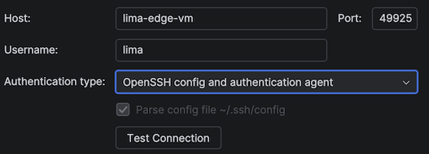

# Feedback

Feedback reagarding tools and libraries; waiting to be passed on to them.


## Lima: Debugging

Lima could ease debugging of provisioning scripts by:

1. Stopping *ANY* later scripts from being executed if one fails.

	Currently, they log:

	```
	INFO[0203] [cloud-init] LIMA 2026-09-18T11:30:25+01:00| WARNING: Failed to execute /mnt/lima-cidata/provision.user/00000004 (as user lima) 
	```
	
	...and continue to the next step.

2. Logging provisioning errors (see above) as `WARN` or `ERROR` log levels.

The YAML and the Makefile currently carry complexity because of this. A good approach could be to try to trim them down, showing where Lima workarounds have been employed.

Doing this would make Lima more expectable. Less surprises is so good!


## Rust Rover: Remote Development with Lima VM without modifying default ssh config

Previuously discussed:

- ["Support Lima ssh config"](https://youtrack.jetbrains.com/issue/IJPL-177504/Support-Lima-ssh.config) (YouTrack; opened Jan'25; closed May'26)

Reported as:

- [PY-92350 Remote Development: targeting Lima VM without modifying default ssh config](https://youtrack.jetbrains.com/issue/PY-92350/Remote-Development-targeting-Lima-VM-without-modifying-default-ssh-config) (YouTrack; Sep'26)

	<!--
	>Could not move it under `Remote Development & Gateway` project. -->

---

Currently (Sep'26; 2026.2.3), Rust Rover provides three ways to authenticate with a remote machine:

- password
- Key pair
- OpenSSH config and authentication agent

All of these have a checkbox `Parse config file ~/.ssh/config` (which is automatically checked for the last option).



In the mean time, Lima VM creates VM-specific configurations:

```
% cat ~/.lima/edge-vm/ssh.config 
# This SSH config file can be passed to 'ssh -F'.
# This file is created by Lima, but not used by Lima itself currently.
# Modifications to this file will be lost on restarting the Lima instance.
Host lima-edge-vm
  IdentityFile "/Users/asko/.lima/_config/user"
  StrictHostKeyChecking no
  UserKnownHostsFile /dev/null
  NoHostAuthenticationForLocalhost yes
  PreferredAuthentications publickey
  Compression no
  BatchMode yes
  IdentitiesOnly yes
  GSSAPIAuthentication no
  Ciphers "^aes128-gcm@openssh.com,aes256-gcm@openssh.com"
  User lima
  ControlMaster auto
  ControlPath "/Users/asko/.lima/edge-vm/ssh.sock"
  ControlPersist yes
  Hostname 127.0.0.1
  Port 49925
```

### Work-around in reality

We can utilize the above configuration file by appending a block in `~/.ssh/config`:

```
Match all
Include ~/.lima/edge-vm/ssh.config
```

The author uses this with the `OpenSSH config and authentication agent` authentication option, since it seems simplest.

All the parameters (host, port, username) need to match the values exposed within the VM specific ssh configuration. Rust Rover uses the values given in its dialog, not the values provided in the ssh config.


### Wish - silver 🥈

One can point Rust Rover manually to the `~/.lima/edge-vm/ssh.config` and connection test would pass.

There seems to be enough data in that file, because if appended to `~/.ssh/config`, connection is indeed possible.


### Wish - platinum 💍

Full awareness of Lima VM.

One gets to see a list of running Lima VM's, and can pick one for remote debugging session.

List can be aquired by `limactl list`. Connection parameters as shown above.

