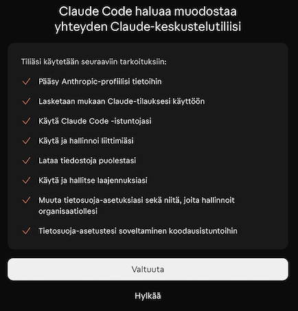

# Agentic development

Instructions on how to use Claude Code on a VM.


## Installing

>Within the VM.

```
$ curl -fsSL https://claude.ai/install.sh | bash
```

Installs Claude Code in `~/.local/bin/claude`. 

Follow the instructions to:

```
$ echo 'export PATH="$HOME/.local/bin:$PATH"' >> ~/.bashrc && source ~/.bashrc
```

Test:

```
$ claude --version
2.1.327 (Claude Code)
```


## Watershed. Claude Pro / Max vs. Anthropic Console

You can use Claude Code with either of two Anthropic offerings. Their intended audience, cost profile etc. are different but the underlying model(s) are the same.

||billing|sign-in|use case|access control|use restrictions|
|---|---|---|---|---|---|
|Claude Pro / Max|subscription|OAuth via browser|individual developer|coarse|5h rolling window|
|Anthropic Console|credits|API keys|organizations, headless use (e.g. CI/CD)|fine|credit balance; rate limits|

>There are also other differences. The Anthropic Console is intended for *organisations* with *teams* and multiple users. The Claude Pro/Max is intended for individual users and lacks access management tools.

You may already have one of these. If you don't, pick either.. Instructions on authentication (below) differ based on your choice.

## Common start

```
$ claude
[...]
Welcome to Claude Code v2.1.327 
..........................................................

     
                                 
            ░░░░░░                        
    ░░░   ░░░░░░░░░░                      
   ░░░░░░░░░░░░░░░░░░░    
                                             
                           ░░░░                     ██
                         ░░░░░░░░░░               ██▒▒██
                                            ▒▒      ██   ▒
       █████████                          ▒▒░░▒▒      ▒ ▒▒
      ██▄█████▄██                           ▒▒         ▒▒
       █████████                           ░          ▒
.......█ █   █ █..........................░..........▒....

 Let's get started.

```

```
Select login method:
 
 ❯ 1. Claude account with subscription · Individual, Team, or Enterprise
   2. Anthropic Console account · API usage billing
   3. 3rd-party platform · Bedrock, Microsoft Foundry, Google Vertex AI
```

## 1. Claude account with subsciption

You'll get a longish URL:

```
https://claude.com/cai/oauth/authorize?code=true&client_id=9d1c[...]&redirect_uri=https[...]
```

- Open [claude.ai](https://claude.ai) in a host side browser and log in.
- Copy-paste the URL to that browser

	>NOTE! The author's setup copied the URL *with newlines* (Nov'26). If you get errors, paste it in a note and remove such.
	>
	>- `Cmd`-double-clicking (which normally opens a URL in a text window) did not work.

	

	Allow the access if you feel like it, and you'll get a code to give back to the terminal.

- You will now see:

	```
	Accessing workspace:

	/home/lima
	```

	Select "No, exit". Claude is now authenticated and it's best you start it within the *work folder*.
  

## 2. Anthropic Console account

*...tbd...*


## Session

```
$ cd SLED   # any project folder
```

```
$ claude
[...]
 Accessing workspace:

 /home/lima/idf-embassy


```

While teaching to co-work with Claude is something this author is only beginning, here are some early tips:

- Use another conversational AI to plan how to use Claude. It can even suggest prompts, and generally lead the path like someone who already knows it.

- Have two terminals open to the VM: one per Claude, one for your own work.

- Naturally, you can also edit the files host-side, in the IDE, and e.g. use its diff viewer to see the suggested changes.


## Updating `claude` CLI

Updates automatically, or you can:

```
$ claude update
```


